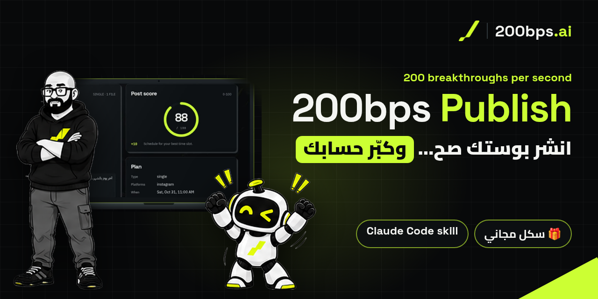

# 200BPS Publish

[العربية](README.md) · **English** · [Arabic guide (PDF)](200bps-publish-README-ar.pdf)



**A free Claude Code skill from [200BPS.ai](https://www.200bps.ai).** Point it at a
folder containing your caption and media. It checks everything, tells you what
it will do, finds your best posting time from your own data, and publishes to
**Instagram and LinkedIn** through [Zernio](https://zernio.com),
but only after you say yes. It also comes with a branded dashboard that mirrors
your Zernio account.

> Built by Nasser Al-Ostath · [200bps.ai](https://www.200bps.ai) · [Instagram](https://www.instagram.com/200bps.ai/) · [LinkedIn](https://www.linkedin.com/in/nasser-al-ostath/)

## What it does

- **Connect accounts from the dashboard.** Instagram and LinkedIn today (more
  later): press Connect, approve on the network's own site, and it's ready to
  post. Your password never touches the skill.
- **Readiness check.** Confirms Python, ffprobe (optional), your `.env` key, your
  Zernio connection, your linked accounts and the add-ons. Anything missing, it
  asks for.
- **Setup wizard, once.** Covers your accounts, search keywords, words you must
  never use, blocked hashtags, a follower goal, Trial Reels, location, LinkedIn
  personal or company, and DM ice breakers.
- **Post checks.** Caption length, the hook before "more", a search keyword in
  the first line, a closing question, **hashtag caps (5 on Instagram and
  LinkedIn)**, restricted wording, and media specs (read-only). Zernio's
  validator runs as a second check before anything is sent.
- **Post score from 0 to 100,** with the tips that raise it.
- **Best time for each day, with evidence.** Each weekday's peak hours come
  with the number of posts behind them, the lift vs your average and a
  confidence level. They're adjusted for where your audience lives (their time
  zones). When there isn't enough data, it says so instead of guessing.
- **Posts tab: see what really happened.** A thumbnail grid (or a list). Every post in your Zernio account
  (draft, scheduled, publishing, published, partly published, failed), plus
  local drafts not uploaded yet. It shows per-platform status, links to the live
  post, error messages and filters, with a "Refresh from Zernio" button.
- **Batch schedule.** Pick several post folders (from this folder, or with **Browse…**,
  which opens your computer's own folder picker; outside folders are copied into `my-posts/`), let it fill
  each post's time from your own best-time data (or one fixed time, every day /
  every 2 days / chosen weekdays), drag to reorder, then type **go** once. Every
  post is created in Zernio as scheduled, with live progress.
- **Cancel anything, anywhere.** From a post's details, the calendar, the Post
  tab, the batch results or Ctrl+K. Scheduled posts are removed from Zernio
  before they go out (your draft stays, so you can reschedule). Published posts
  are removed where the network allows it; Instagram posts are deleted in the
  Instagram app. You type **cancel** to confirm.
- **New post, anytime.** Clear the Post tab to start fresh. Nothing is deleted;
  earlier drafts wait under Posts → Not uploaded.
- **Undo anything before you publish.** Use ↺ on each step, or revert any
  single change from the Changes timeline.
- **Growth settings per post:**
  - Instagram: Trial Reels, custom Reel cover, location, first comment, collaborators
  - LinkedIn: document title and company page
- **DM gifts, only with your permission.** For example, "comment *skill* and
  get it in your DMs". The gift can require people to follow you first.
- **Caption fixes you approve.** When a check fails, click it (or let Claude
  notice). Claude writes a fix and shows a before/after with the score change.
  You can approve, edit or reject it, and your original is always backed up.
- **Reel covers.** Pick a frame from the video, use your own image, or let
  Claude design one in your brand. You see it in the profile-grid crop before posting.
- **Pop-up decisions.** When Claude needs you, a pop-up asks. You can answer
  there or in the chat, and the first answer wins.
- **One-click publish, verified.** Press **Publish**, type **go**, and the
  dashboard uploads the post to Zernio, then reads it back from your Zernio
  account to prove it's there (status, time, links).
- **Dashboard in Arabic and English:**
  - the post preview and plan
  - growth KPIs, the follower curve and your goal ring
  - top posts, an engagement heatmap and audience data
  - calendar, comments waiting, automations and ice breakers
  - an idea bank that refills after every post ("Get ideas" anytime); click an idea for its hook, outline and call to action
  - your posting streak and what changed since your last visit
  - a journey bar (Check → Cover → Time → Gift → Go) with one "Next step" button
  - a Plan tab: click any calendar day or heatmap hour to schedule, move or plan a post
  - a command bar (Ctrl/⌘ + K), light/dark mode, and 12h/24h time
  - hover tips: rest the mouse on anything for a short explanation, and a full feature guide in Settings → About (or Ctrl+K → Guide)
  - a quiet animated background of the 200bps.ai mark and name that follows your mouse with depth (off with "reduce motion")

The dashboard opens by itself whenever the skill runs, and works on any screen
size: phone, tablet or desktop, in light or dark mode.

Nothing is published, scheduled or automated until you approve it.

## Requirements

- [Claude Code](https://claude.com/claude-code)
- Python 3.9 or newer. No pip installs needed.
- A [Zernio](https://zernio.com) account and API key, with your accounts connected
  (Instagram needs a Business or Creator account).
  - The Analytics add-on powers best time, insights and the dashboard numbers.
  - The Inbox add-on powers comments and DM gifts.
- Optional: ffmpeg/ffprobe, to verify video specs.

## API keys: what you need and how to set them up

The skill needs **one key: your Zernio API key**. It connects the skill to your accounts and publishes for you.

**1. Get the key**

1. Sign up at [zernio.com](https://zernio.com).
2. Connect your accounts: **Instagram** (must be a **Business or Creator** account) and **LinkedIn**.
3. Go to **Settings → API keys**, create a new key and copy it.
4. Optional but recommended: turn on the **Analytics** add-on (best time, dashboard numbers) and the **Inbox** add-on (comments, DM gifts).

**2. Save it in the skill (two ways)**

- **Easiest, from the dashboard:** run `/200bps-publish set me up`, paste the key into the **Connect Zernio** card (or **Settings → Keys**) and press **Save**. It's tested right away and shown masked from then on.
- **By hand, in `.env`:** in your working folder (**not** inside the skill folder), copy `.env.example` to `.env` and paste the key after the `=`:

```bash
# my-posts/.env   ← your working folder, never the skill folder
ZERNIO_API_KEY=<your-key>
```

**3. Check it works**

In the dashboard press **Test** next to the key; you'll see **✓ Connected** and your account count. Or ask Claude to run `bps.py doctor` for the full readiness check.

> Never put a key in a chat, a commit or a screenshot. It lives only in `.env`, readable only by you, and `.gitignore` keeps it out of git. If it leaks, revoke it in Zernio and create a new one.

## Install (try it in a test folder)

**Option 1: release zip.** Download the latest `200bps-publish-vX.Y.Z.zip` from
[Releases](<GITHUB_URL>/releases), then:

```bash
mkdir my-posts && cd my-posts
mkdir -p .claude/skills
unzip ~/Downloads/200bps-publish-v1.15.0.zip -d .claude/skills/
claude
```

**Option 2: clone from GitHub.**

```bash
mkdir my-posts && cd my-posts
mkdir -p .claude/skills
git clone <GITHUB_URL> .claude/skills/200bps-publish
claude
```

The folder must be named `200bps-publish` inside `.claude/skills/`.

Then in Claude Code:

```
/200bps-publish set me up
```

The dashboard opens with a **Connect Zernio** card. Paste your Zernio API key
there and press **Save**; it's tested right away. Keys are stored only in the
`.env` file in your folder, with owner-only permissions, and are never shown in
full again. You can add other API keys under **Settings → Keys**. Never paste a
key into the chat.

## Use

Make one folder per post:

```
posts/agent-anatomy/
  caption.txt              main caption (required)
  caption.linkedin.txt     optional per-platform version
  01.jpg 02.jpg …          media, posted in name order (or one .mp4 for a Reel, or a .pdf for LinkedIn)
  cover.jpg                optional Reel cover, 1080x1920
```

```
/200bps-publish posts/agent-anatomy
```

Other things you can ask for:
- "open my dashboard"
- "report on my last post"
- "give me post ideas"
- "set my ice breakers"

## Privacy and safety

- Your key stays in your own `.env`. It is never written into the skill, shown
  in the dashboard, or sent anywhere except `zernio.com`.
- The dashboard runs only on `127.0.0.1` and is read-only. It cannot publish.
- `tools/secret_scan.py` runs before every release build (`tools/package.py`).

## License

The code is MIT. The 200BPS.ai name, mark and visual identity are not; see
[BRAND.md](BRAND.md). Please keep the "Built by 200BPS.ai" credit.
