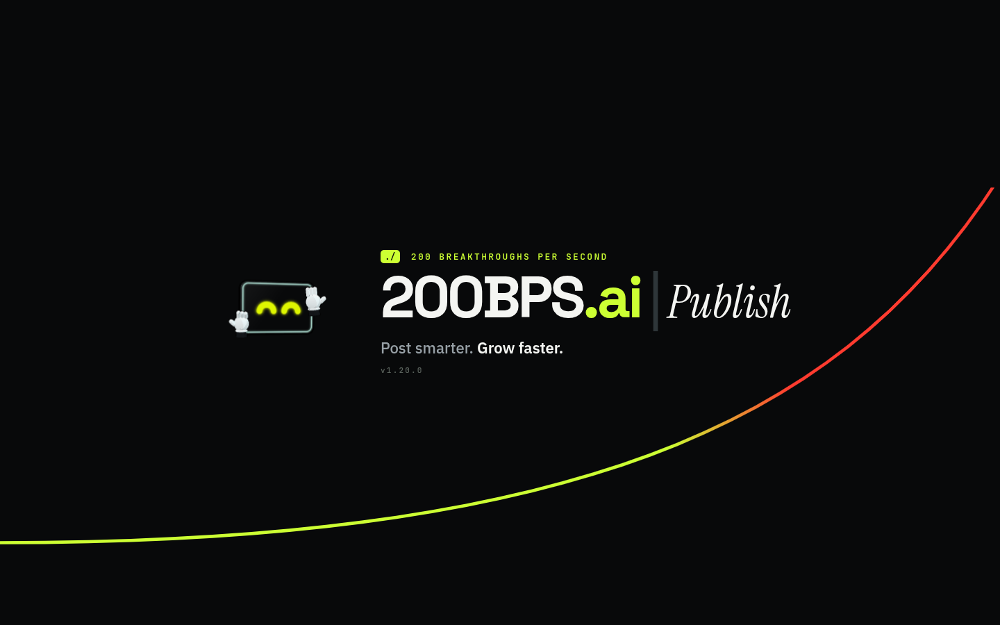
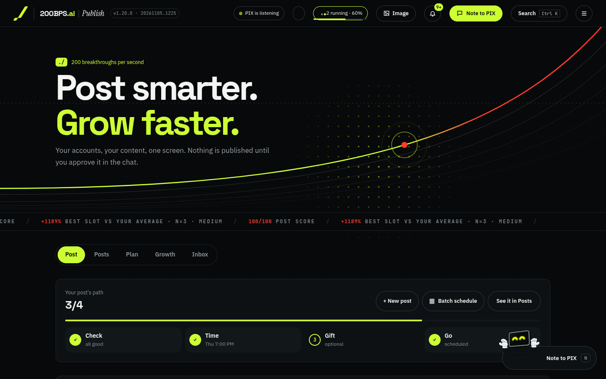
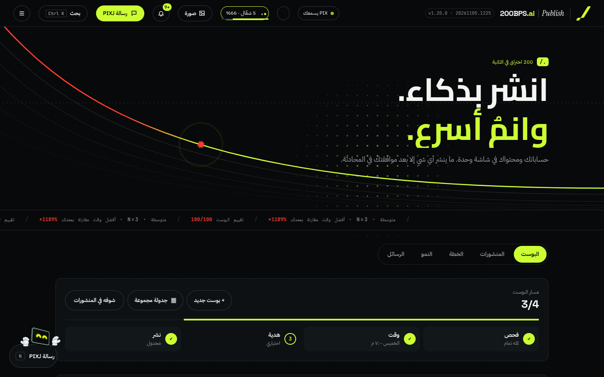
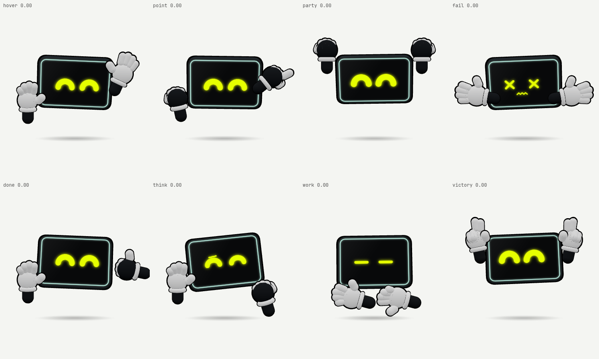
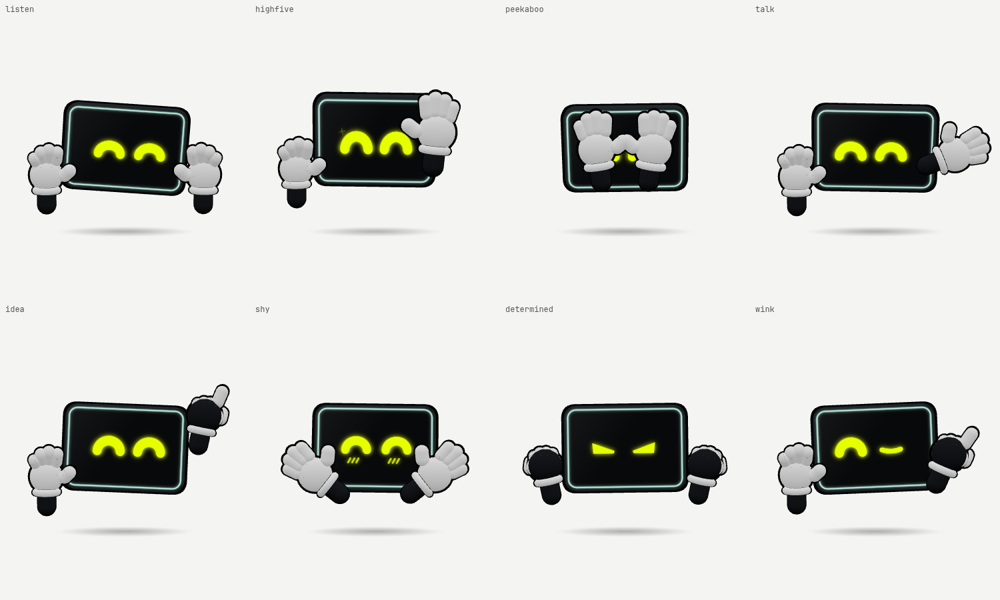
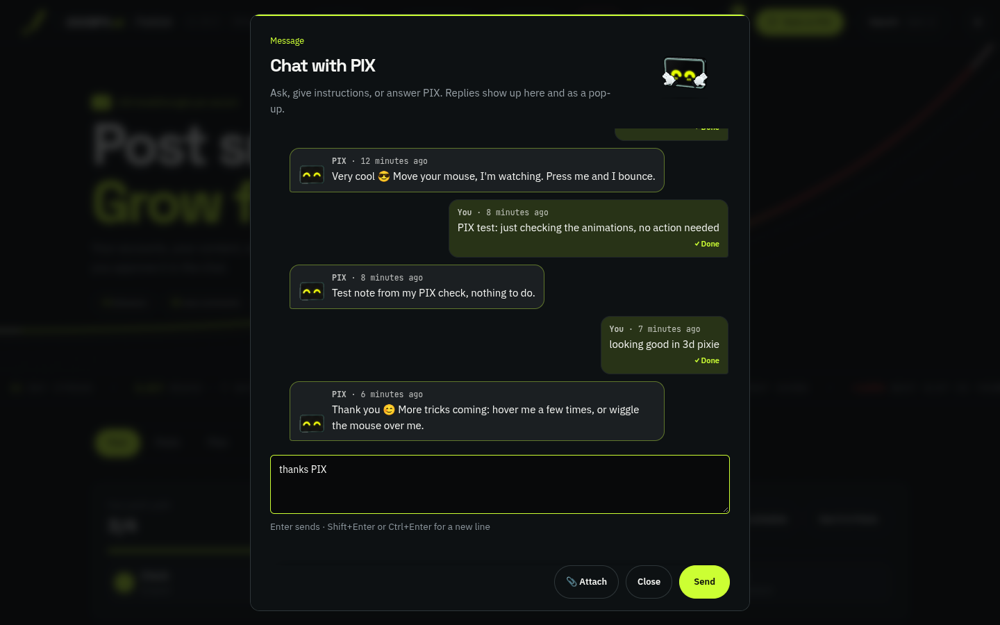
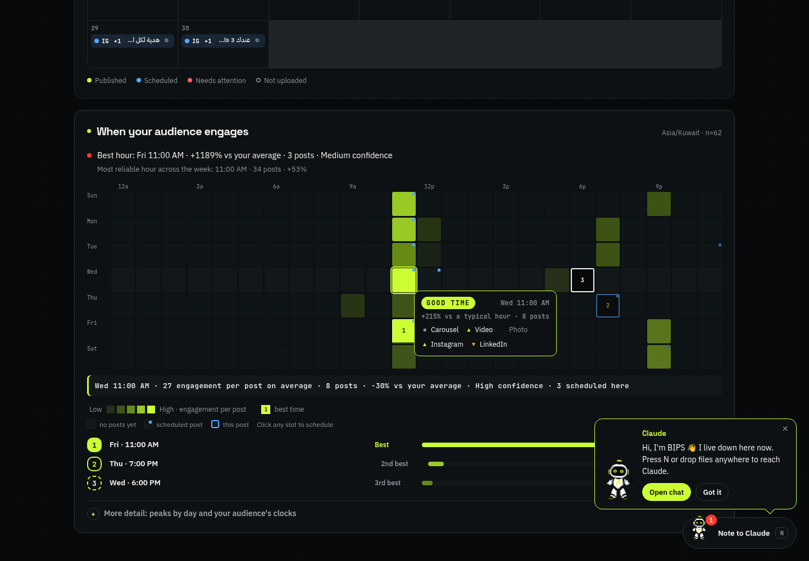
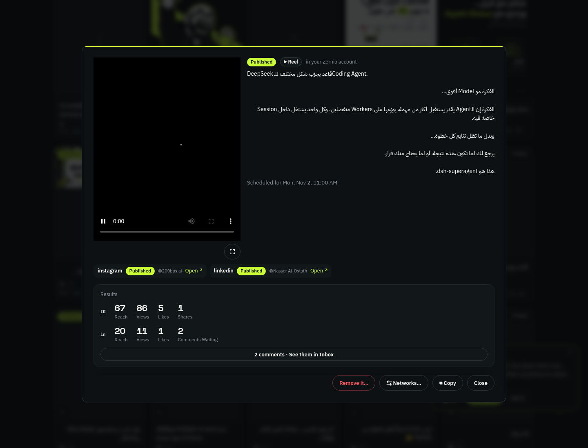
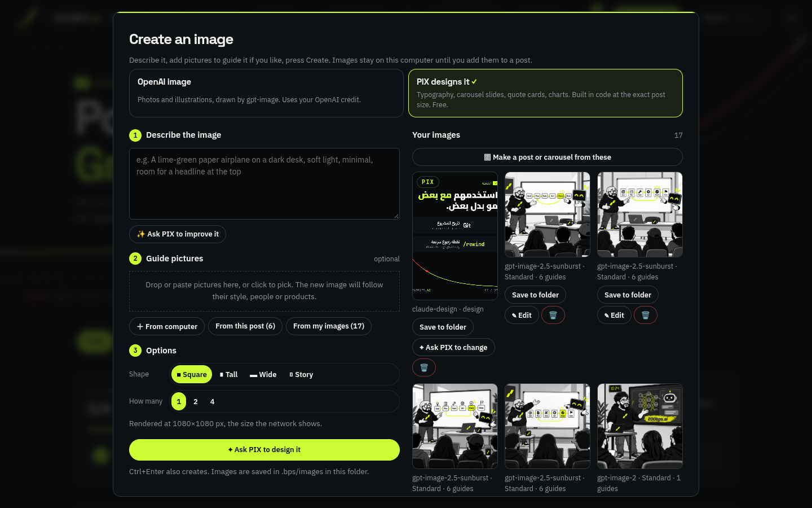

# 200BPS.ai | Publish

[العربية](README.md) · **English** · [Arabic guide (PDF)](200bps-publish-README-ar.pdf)



**A free Claude Code plugin from [200BPS.ai](https://www.200bps.ai).** Point it at a folder with your caption and media.
It checks everything, scores the post, finds your best time from **your own** data, fits the caption to each network,
and publishes to **Instagram, LinkedIn, Facebook, TikTok and Snapchat** through [Zernio](https://zernio.com), but only
after you type **go**. A live bilingual dashboard (English / Arabic) runs on your computer, with **PIX**, a 3D assistant
you can talk to.

> Built by Nasser Al-Ostath · [200bps.ai](https://www.200bps.ai) · [Instagram](https://www.instagram.com/200bps.ai/) · [LinkedIn](https://www.linkedin.com/in/nasser-al-ostath/)

## Install (plugin, recommended)

In Claude Code:

```
/plugin marketplace add artisanv/200bps-publish
/plugin install 200bps-publish@200bps
```

(On Claude Code 2.1.275 or later, one line does both: `/plugin install 200bps-publish --marketplace artisanv/200bps-publish`.)

Then **turn on auto-update** once, so you always get the newest version: `/plugin` → **Marketplaces** → **200bps** →
**Enable auto-update**. Restart Claude Code, open it in your posts folder and type:

```
/200bps-publish set me up
```

The dashboard opens by itself. Paste your Zernio API key in the **Connect Zernio** card. That's it.

**Update by hand:** `/plugin marketplace update 200bps`. **Remove:** `/plugin uninstall 200bps-publish@200bps`.

## From a skill to a plugin

200BPS Publish started as a **Claude Code skill**: a folder you unzipped into `.claude/skills/`. It grew into a full app
(a local web dashboard, a listener that wakes Claude when you click, background jobs, a 3D assistant), so from v1.20 it
ships as a **plugin**:

| | Skill (before) | Plugin (now) |
|---|---|---|
| Install | download a zip, unzip into `.claude/skills/` | two commands in Claude Code |
| Updates | download every new zip | automatic (after you enable auto-update) |
| What's inside | the skill | the same skill, in `skills/200bps-publish/` |

The skill still works on its own: you can copy `skills/200bps-publish/` into your project's `.claude/skills/` folder
(or use the zip from [Releases](https://github.com/artisanv/200bps-publish/releases)). Your workspace data (`.env`,
`.bps/`) is never inside the plugin and is never touched by updates.

## See it

| | |
|---|---|
|  |  |
| **The dashboard**: a self-drawing growth curve, a live strip of your real numbers, PIX in the corner. | **Arabic**, right to left, all the way. |
|  |  |
| **PIX in 3D**, true to its model sheet: waving, pointing, celebrating, X-eyes shrug, thumbs-up, thinking, typing, peace. | High five, peekaboo, presenting, ideas, shy, determined, wink… |
|  |  |
| **Chat with PIX**: ask how anything works, or ask it to do things. Public actions still wait for your go. | **Heatmap verdict**: point at any hour: good, OK or weak, and for which format and network. |
|  |  |
| **Posts**: play a Reel with sound inside the dashboard, with its results per network. | **Images**: OpenAI paints, or **PIX designs it** in code at the exact post size, free. |

## New in v1.20.0 (the big one)

- **🧪 Trial Reels for waiting Reels.** Turn any scheduled Instagram Reel into a Trial Reel, with advice from your
  own results and Instagram's rules; PIX helps. Plan shows every network of each post as its own badge.
- **🌍 Audience per account.** Each account's own Growth page shows where its followers are (Instagram, Facebook
  Pages, LinkedIn company pages). The idea bank now shows on every Growth tab.
- **🧪 Trial Reel switch.** Tick Trial Reel on any Instagram Reel (Network settings) to show it to non-followers
  first, then pick what happens after: Automatic (shared to your followers if it does well) or Manual. New Reels
  start with Trial off; set your default in Settings.
- **PIX, your assistant, in 3D.** A live 3D model built from the PIX model sheet (screen, mint border, lime eyes, the
  back with screws and the 200BPS.AI mark, cel-shaded cartoon gloves). It follows your mouse, blinks, does a different
  trick each time you hover (wave, peekaboo, high five, wink, peace, a full spin, cheer), gets shy if you wiggle the mouse
  over it, and acts out what's happening: listening, typing while it works, "…" while it thinks, thumbs-up when done,
  X-eyes shrug when something failed, asleep when Claude Code is closed.
- **Talk to PIX.** "Note to PIX" (press **N** anywhere, or drop files anywhere on the page). PIX knows every feature and
  can do anything the app does from the chat. Nothing public happens without your yes or a typed **go**.
- **A new look:** 200bps Brand System v2, a 2.6-second splash, the curve, the evidence ticker, soft geometry, purposeful motion.
- **✦ PIX designs it:** a second image engine: designs in code (carousel slides, quote cards, charts) at the exact post size. Free.
- **New OpenAI image models show up by themselves** (checked daily, with a "try it / make it default" notice).
- **Heatmap verdict**, **■ Stop** anything running, **⊘ Ignore** comments, **Post to** switches per network,
  **▶ play videos with sound** with their results, **1-5** to switch tabs, folded passed checks.
- **✨ Fit it for every network:** one caption, rewritten for each network's rules, with the score change.

## New in v1.19.0

- **🅰🅱 Test two hooks:** one Reel, two first lines (or covers), posted as Instagram Trial Reels to non-followers only. After 48 hours, compare skip rate and watch time and share the winner to your followers.

## New in v1.18.0

- **LinkedIn polls:** a question, 2-4 choices and how long it stays open, with a live preview. No media needed.
- **LinkedIn reposts:** paste a LinkedIn post link; your caption becomes your comment above it.
- **Text posts:** New post works with just a caption (LinkedIn and Facebook).
- **See your poll** before scheduling (Preview) and after (Posts / Plan): the poll card, time left, LinkedIn's numbers, and a link to the votes.
- **♻ Recycle your best posts:** Zernio re-posts a top post every few weeks or months with fresh hooks Claude writes. Starts only after a typed go; stop any time.
- **Since v1.16:** turn networks on or off per post, post to several accounts on one network, copy & paste posts in Plan, one dashboard per network with its own goal, archives (.zip, .7z, .rar) as posts, PDF to LinkedIn + photos to the rest in one post, Claude drafts your comment replies, the gift funnel, Inbox knows what you did in the Instagram app, Reels up to 15 minutes.

## New in v1.16.0

- **Facebook, TikTok and Snapchat.** Connect them like Instagram and LinkedIn. A post goes to every network that can show it, and the rest are skipped with the reason. Facebook: Feed post, Reel or Story, first comment, save as a Facebook draft, pick the Page. TikTok: who can see it, comments/duets/stitches, promotional and AI labels, send to your TikTok inbox as a draft, and TikTok's required "I previewed it and agree" (yours only, asked again after any change). Snapchat: Story, Saved story or Spotlight.
- **New post in 4 steps:** media & caption → check & improve (Claude's fixes appear right there) → time → review & schedule.
- **Edit images like ChatGPT:** pin, box, paint or circle the spots to change, a note for each, full screen. Only the marked spots change; everything else stays pixel-for-pixel. Edit any picture from your computer, and save with your own file manager.
- **Plan in Month, Week or Day.** Drag a post to move it, click or drag an empty time to plan one, edit a scheduled caption.
- **Inbox:** every comment with its post and the post's gift; reply, send the gift privately, hide, delete, label.
- **Notes to Claude show live status** (got it → working → done), a notice when Claude finishes, and an **Activity** bell with everything.
- **A gift you can read at a glance:** one sentence plus a live storyboard of what people will see.
- **Idea bank tools** (select, delete with undo, edit, add, save as .md or .json, load), a **full post viewer** (every slide, the full video, the PDF) and **color-blind mode**.

See [CHANGELOG.md](CHANGELOG.md) for the full list.

## What it does

- **Connect accounts from the dashboard.** Instagram, LinkedIn, Facebook, TikTok
  and Snapchat: press Connect, approve on the network's own site, and it's ready to
  post. Your password never touches the skill.
- **Readiness check.** Confirms Python, ffprobe (optional), your `.env` key, your
  Zernio connection, your linked accounts and the add-ons. Anything missing, it
  asks for.
- **Setup wizard, once.** Covers your accounts, search keywords, words you must
  never use, blocked hashtags, a follower goal, Trial Reels, location, LinkedIn
  personal or company, and DM ice breakers.
- **Post checks.** Caption length, the hook before "more", a search keyword in
  the first line, a closing question, **hashtag caps (5 on Instagram and
  LinkedIn)**, restricted wording, and media specs (read-only). Zernio's
  validator runs as a second check before anything is sent.
- **Post score from 0 to 100,** with the tips that raise it.
- **Best time for each day, with evidence.** Each weekday's peak hours come
  with the number of posts behind them, the lift vs your average and a
  confidence level. They're adjusted for where your audience lives (their time
  zones). When there isn't enough data, it says so instead of guessing.
- **Posts tab: see what really happened.** A thumbnail grid (or a list). Every post in your Zernio account
  (draft, scheduled, publishing, published, partly published, failed), plus
  local drafts not uploaded yet. It shows per-platform status, links to the live
  post, error messages and filters, with a "Refresh from Zernio" button.
- **Batch schedule.** Pick several post folders (from this folder, or with **Browse…**,
  which opens your computer's own folder picker; outside folders are copied into `my-posts/`), let it fill
  each post's time from your own best-time data (or one fixed time, every day /
  every 2 days / chosen weekdays), drag to reorder, then type **go** once. Every
  post is created in Zernio as scheduled, with live progress.
- **Cancel anything, anywhere.** From a post's details, the calendar, the Post
  tab, the batch results or Ctrl+K. Scheduled posts are removed from Zernio
  before they go out (your draft stays, so you can reschedule). Published posts
  are removed where the network allows it; Instagram posts are deleted in the
  Instagram app. You type **cancel** to confirm.
- **New post, anytime.** Clear the Post tab to start fresh. Nothing is deleted;
  earlier drafts wait under Posts → Not uploaded.
- **Undo anything before you publish.** Use ↺ on each step, or revert any
  single change from the Changes timeline.
- **Growth settings per post:**
  - Instagram: Trial Reels, custom Reel cover, location, first comment, collaborators
  - LinkedIn: document title and company page
- **DM gifts, only with your permission.** For example, "comment *skill* and
  get it in your DMs". The gift can require people to follow you first.
- **Caption fixes you approve.** When a check fails, click it (or let Claude
  notice). Claude writes a fix and shows a before/after with the score change.
  You can approve, edit or reject it, and your original is always backed up.
- **Reel covers.** Pick a frame from the video, use your own image, or let
  Claude design one in your brand. You see it in the profile-grid crop before posting.
- **Pop-up decisions.** When Claude needs you, a pop-up asks. You can answer
  there or in the chat, and the first answer wins.
- **One-click publish, verified.** Press **Publish**, type **go**, and the
  dashboard uploads the post to Zernio, then reads it back from your Zernio
  account to prove it's there (status, time, links).
- **Dashboard in Arabic and English:**
  - the post preview and plan
  - growth KPIs, the follower curve and your goal ring
  - top posts, an engagement heatmap and audience data
  - calendar, comments waiting, automations and ice breakers
  - an idea bank that refills after every post ("Get ideas" anytime); click an idea for its hook, outline and call to action
  - your posting streak and what changed since your last visit
  - a journey bar (Check → Cover → Time → Gift → Go) with one "Next step" button
  - a Plan tab: click any calendar day or heatmap hour to schedule, move or plan a post
  - a command bar (Ctrl/⌘ + K), light/dark mode, and 12h/24h time
  - hover tips: rest the mouse on anything for a short explanation, and a full feature guide in Settings → About (or Ctrl+K → Guide)
  - a quiet animated background of the 200bps.ai mark and name that follows your mouse with depth (off with "reduce motion")

The dashboard opens by itself whenever the skill runs, and works on any screen
size: phone, tablet or desktop, in light or dark mode.

Nothing is published, scheduled or automated until you approve it.

## Requirements

- [Claude Code](https://claude.com/claude-code)
- Python 3.9 or newer. No pip installs needed.
- A [Zernio](https://zernio.com) account and API key, with your accounts connected
  (Instagram needs a Business or Creator account).
  - The Analytics add-on powers best time, insights and the dashboard numbers.
  - The Inbox add-on powers comments and DM gifts.
- Optional: ffmpeg/ffprobe, to verify video specs.

## API keys: what you need and how to set them up

The skill needs **one key: your Zernio API key**. It connects the skill to your accounts and publishes for you.

**1. Get the key**

1. Sign up at [zernio.com](https://zernio.com).
2. Connect your accounts: **Instagram** (must be a **Business or Creator** account) and **LinkedIn**, plus, if you like, **Facebook** (a Page), **TikTok** and **Snapchat** (a Public Profile).
3. Go to **Settings → API keys**, create a new key and copy it.
4. Optional but recommended: turn on the **Analytics** add-on (best time, dashboard numbers) and the **Inbox** add-on (comments, DM gifts).

**2. Save it in the skill (two ways)**

- **Easiest, from the dashboard:** run `/200bps-publish set me up`, paste the key into the **Connect Zernio** card (or **Settings → Keys**) and press **Save**. It's tested right away and shown masked from then on.
- **By hand, in `.env`:** in your working folder (**not** inside the skill folder), copy `.env.example` to `.env` and paste the key after the `=`:

```bash
# my-posts/.env   ← your working folder, never the skill folder
ZERNIO_API_KEY=<your-key>
```

**3. Check it works**

In the dashboard press **Test** next to the key; you'll see **✓ Connected** and your account count. Or ask Claude to run `bps.py doctor` for the full readiness check.

> Never put a key in a chat, a commit or a screenshot. It lives only in `.env`, readable only by you, and `.gitignore` keeps it out of git. If it leaks, revoke it in Zernio and create a new one.

## Install (try it in a test folder)

**Option 1: release zip.** Download the latest `200bps-publish-vX.Y.Z.zip` from
[Releases](https://github.com/artisanv/200bps-publish/releases), then:

```bash
mkdir my-posts && cd my-posts
mkdir -p .claude/skills
unzip ~/Downloads/200bps-publish-v1.20.0.zip -d .claude/skills/
claude
```

**Option 2: clone from GitHub.**

```bash
mkdir my-posts && cd my-posts
mkdir -p .claude/skills
git clone https://github.com/artisanv/200bps-publish .claude/skills/200bps-publish
claude
```

The folder must be named `200bps-publish` inside `.claude/skills/`.

Then in Claude Code:

```
/200bps-publish set me up
```

The dashboard opens with a **Connect Zernio** card. Paste your Zernio API key
there and press **Save**; it's tested right away. Keys are stored only in the
`.env` file in your folder, with owner-only permissions, and are never shown in
full again. You can add other API keys under **Settings → Keys**. Never paste a
key into the chat.

## Use

Make one folder per post:

```
posts/agent-anatomy/
  caption.txt              main caption (required)
  caption.linkedin.txt     optional per-platform version
  01.jpg 02.jpg …          media, posted in name order (or one .mp4 for a Reel, or a .pdf for LinkedIn)
  cover.jpg                optional Reel cover, 1080x1920
```

```
/200bps-publish posts/agent-anatomy
```

Other things you can ask for:
- "open my dashboard"
- "report on my last post"
- "give me post ideas"
- "set my ice breakers"

## Privacy and safety

- Your keys stay in your own `.env`. They are never written into the skill or
  shown in full in the dashboard, and they go only to their own service:
  the Zernio key to `zernio.com`, the OpenAI key (optional, for images) to
  `api.openai.com`.
- The dashboard runs only on `127.0.0.1`. It publishes, schedules, moves or
  deletes only after you type the confirm word (go, move, edit, cancel, delete).
- TikTok's consent is always yours: Claude can't give it for you.
- `tools/secret_scan.py` runs before every release build (`tools/package.py`).

## License

The code is MIT. The 200BPS.ai name, mark and visual identity are not; see
[BRAND.md](BRAND.md). Please keep the "Built by 200BPS.ai" credit.
