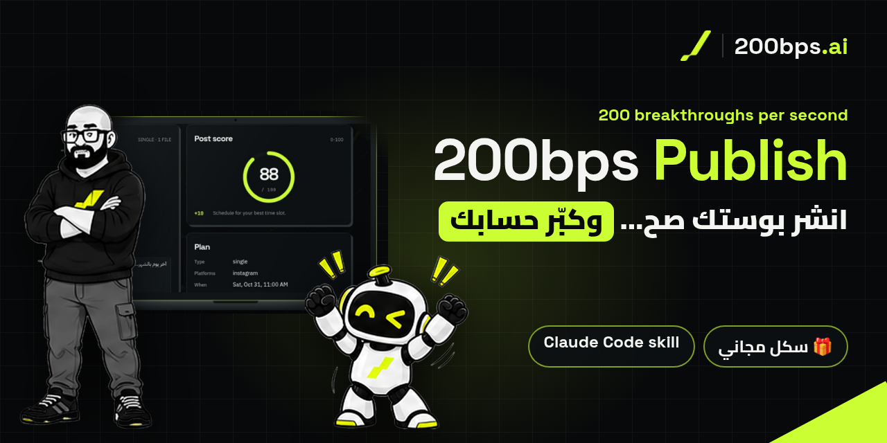

<div dir="rtl">

<p align="center">
  
</p>

<p align="center">
  <b>العربية</b> · <a href="README.en.md">English</a>
</p>

<p align="center">
  
  
  
  
</p>

# 200bps Publish

### انشر بوستك صح… وكبّر حسابك.

**سكل مجاني لـ Claude Code سوّيته لكم من [200bps.ai](https://www.200bps.ai).**
تعطيه فولدر البوست (الكابشن والصور أو الفيديو)، وهو يشيّك على كل شي، يعطيك سكور من 100، يطلع لك أحسن وقت تنزّل فيه **من أرقامك إنت**، ويجدول أو ينزّل البوست على **انستقرام، لينكدإن، فيسبوك، تيك توك وسناب شات** عن طريق [Zernio](https://zernio.com).

> **ولا شي ينزل إلا لما تكتب `go` بنفسك.**

📄 **نسخة PDF:** [200bps-publish-README-ar.pdf](200bps-publish-README-ar.pdf)

> سوّاه ناصر الأستاذ · [200bps.ai](https://www.200bps.ai) · [Instagram](https://www.instagram.com/200bps.ai/) · [LinkedIn](https://www.linkedin.com/in/nasser-al-ostath/)

---

## 📌 المحتويات

- [شنو يسوي؟](#-شنو-يسوي)
- [الجديد في 1.19.0](#-الجديد-في-1190)
- [الجديد في 1.18.0](#-الجديد-في-1180)
- [الجديد في 1.16.0](#-الجديد-في-1160)
- [المميزات](#-المميزات)
- [الداشبورد](#-الداشبورد)
- [شنو تحتاج؟](#-شنو-تحتاج)
- [المفاتيح (API keys)](#-المفاتيح-api-keys)
- [التنصيب](#-التنصيب)
- [أول تشغيل](#-أول-تشغيل)
- [شلون تستخدمه؟](#-شلون-تستخدمه)
- [الأمان والخصوصية](#-الأمان-والخصوصية)
- [أسئلة دايماً تنسأل](#-أسئلة-دايماً-تنسأل)
- [الرخصة والهوية](#-الرخصة-والهوية)

---

## ✨ شنو يسوي؟

عندك بوست جاهز… بس بأي وقت تنزّله؟ وشلون تدري إنه زين؟

**200bps Publish** يشتغل داخل Claude Code على جهازك:

1. **تعطيه الفولدر** — كابشن + صورة، كاروسيل، ريل، أو PDF للينكدإن.
2. **يشيّك على كل شي** — الهوك، الهاشتاقات، طول الكابشن، الكلمات الممنوعة، ومقاسات الصور والفيديو.
3. **يعطيك سكور من 100** — ومعاه نصايح ترفعه، وتعديلات للكابشن توافق عليها أو تعدّلها أو ترفضها.
4. **يختار الوقت** — من بيانات حسابك إنت، مو تخمين. ما عنده بيانات كافية؟ يقول لك بصراحة ويسألك.
5. **ينتظر الـ `go` مالتك** — وبعدها ينزّل أو يجدول، ويرجع يتأكد من Zernio إن البوست فعلاً موجود.

وكل هذا وقدامك **داشبورد** بهوية 200bps.ai يعرض حسابك كله، بالعربي والإنقليزي.

---

## 🆕 الجديد في 1.19.0

- **🅰🅱 جرّب هوكين:** ريل واحد بسطرين أول مختلفين (أو كفرين)، ينزلون كـ Trial Reels بانستقرام لغير المتابعين بس. بعد 48 ساعة قارن نسبة التخطي ووقت المشاهدة وشارك الفايز مع متابعينك.

## 🆕 الجديد في 1.18.0

- **تصويت في لينكدإن:** سؤال، ومن 2 إلى 4 خيارات، وكم يظل مفتوح، مع معاينة حيّة. بدون صور.
- **إعادة نشر في لينكدإن:** الصق رابط بوست لينكدإن؛ والكابشن مالك يصير تعليقك فوقه.
- **بوست نص:** البوست الجديد يشتغل بالكابشن بس (لينكدإن وفيسبوك).
- **شوف تصويتك** قبل الجدولة (المعاينة) وبعدها (المنشورات / الخطة): كرت التصويت، الوقت الباقي، أرقام لينكدإن، ورابط الأصوات.
- **♻ أعد تدوير أفضل بوستاتك:** Zernio يعيد نشر أحسن بوست كل كم أسبوع أو شهر بهوكات جديدة يكتبها كلود. ما يبدأ إلا لما تكتب go؛ وتوقفه متى ما تبي.
- **من بعد 1.16:** تشغيل وإطفاء المنصات لكل بوست، النشر لأكثر من حساب بنفس المنصة، نسخ ولصق البوستات في الخطة، داشبورد لكل منصة بهدفها الخاص، الملفات المضغوطة (.zip و.7z و.rar) كبوستات، الـPDF للينكدإن والصور للباقي ببوست واحد، كلود يكتب ردودك على التعليقات، مسار الهدية، الرسائل تعرف شنو سويت بتطبيق انستقرام، والريلز لين 15 دقيقة.

## 🆕 الجديد في 1.16.0

- **فيسبوك، تيك توك وسناب شات.** تربطهم مثل انستقرام ولينكدإن. البوست يروح لكل منصة تقدر تعرضه، والباقي ينتجاهل مع السبب. فيسبوك: بوست عادي أو ريل أو ستوري، أول تعليق، مسودة بفيسبوك، واختيار الصفحة. تيك توك: منو يشوفه، التعليقات/الدويت/الستيتش، علامة الترويج والذكاء الاصطناعي، إرساله كمسودة لصندوق تيك توك، وموافقة تيك توك المطلوبة "شفته وأوافق" (منك إنت بس، وتنطلب مرة ثانية بعد أي تغيير). سناب شات: ستوري، ستوري محفوظة أو سبوتلايت.
- **بوست جديد بـ4 خطوات:** الملفات والكابشن ← افحص وحسّن (تعديلات كلود تطلع هني) ← الوقت ← راجع وجدول.
- **تعديل الصور مثل ChatGPT:** دبوس، مربع، تلوين أو تحويط على الأماكن اللي تتغيّر، ملاحظة لكل وحدة، وملء الشاشة. بس الأماكن المحددة تتغيّر؛ والباقي يظل نفسه بالضبط. تعدّل أي صورة من جهازك، وتحفظ بمدير الملفات مالك.
- **الخطة: شهر، أسبوع أو يوم.** اسحب البوست عشان تنقله، اضغط أو اسحب على وقت فاضي عشان تخطط واحد، وعدّل كابشن المجدول.
- **الرسائل:** كل تعليق مع البوست اللي عليه وهديته؛ رد، أرسل الهدية بالخاص، اخفِ، احذف، وصنّف.
- **ملاحظاتك لكلود تبين حالتها** (وصلت ← يشتغل ← خلصت)، وتنبيه لما يخلّص، وجرس **النشاط** فيه كل شي.
- **الهدية واضحة من أول نظرة:** جملة وحدة ومشاهد حيّة لشنو بيشوفون الناس.
- **أدوات بنك الأفكار** (اختيار، حذف مع تراجع، تعديل، إضافة، حفظ ‎.md‎ أو ‎.json‎، وتحميل)، **عارض البوست الكامل** (كل الشرائح، الفيديو كامل، الـPDF) و**وضع عمى الألوان**.

القائمة الكاملة في [CHANGELOG.md](CHANGELOG.md).

---

## 🚀 المميزات

### ✅ يشيّك على البوست
| الميزة | شنو تسوي |
|---|---|
| فحص الجاهزية | يتأكد من بايثون، المفتاح، الاتصال بـ Zernio، الحسابات المربوطة والإضافات. أي شي ناقص يقول لك شلون تصلّحه. |
| فحص الكابشن | الهوك قبل "المزيد"، كلمة بحث بأول سطر، سؤال بالنهاية، حد الهاشتاقات (5 بانستقرام ولينكدإن)، والكلمات اللي ما تبيها. |
| فحص الميديا | المقاسات والأبعاد (قراءة بس، ما يغيّر ملفاتك)، ويمرّ على فاحص Zernio قبل لا يرسل. |
| سكور من 100 | رقم واحد واضح، ومعاه النصايح اللي ترفعه. |
| تعديلات توافق عليها | كلود يكتب التعديل ويوريك قبل وبعد مع فرق السكور. توافق، تعدّل، أو ترفض — والأصلي دايماً محفوظ. |
| تراجع عن أي شي | ↺ على كل خطوة، أو ترجع أي تعديل من سجل التغييرات، قبل لا تنشر. |

### ⏰ الوقت والجدولة
| الميزة | شنو تسوي |
|---|---|
| أحسن وقت بالأدلة | لكل يوم بالأسبوع: أحسن ساعة، كم بوست وراها، نسبة الزيادة عن معدّلك، ودرجة الثقة — ومحسوبة على توقيت جمهورك. |
| الكالندر | كل بوست بيومه وبلون حالته. تضغط أي يوم أو أي ساعة بالخريطة الحرارية وتجدول أو تحرّك. |
| جدولة مجموعة بوستات | تختار كذا فولدر ← يعبّي الأوقات من بياناتك (أو وقت ثابت: كل يوم، كل يومين، أو أيام تختارها) ← تكتب `go` **مرة وحدة**. كل بوست ينزل مجدول، مو "انشر الحين". |
| الإلغاء من أي مكان | المجدول ينشال من Zernio قبل لا ينزل (والمسودة تظل عندك). المنشور ينشال من المنصات اللي تسمح. تكتب `cancel` عشان تأكّد. |

### 📲 النشر والإدارة
| الميزة | شنو تسوي |
|---|---|
| نشر بضغطة، ومتأكد منه | تضغط **Publish**، تكتب `go`، وهو يرفع ويرجع يقرا البوست من Zernio عشان يثبت إنه موجود (الحالة، الوقت، الروابط). |
| تبويب البوستات | كل بوستاتك: المنشور، المجدول، اللي يبيله تعديل، والمسودات — بصورها وروابطها ورسائل الأخطاء. |
| بوست جديد بدون ما تكتب مسارات | صور أو فيديو من جهازك (سحب وإفلات)، أو فولدر بوست، ترتّبهم وتسمّي البوست. |
| كفر الريل | تختار فريم من الفيديو، أو صورتك، أو تخلي كلود يصمم واحد بهويتك — وتشوفه بقصّة شبكة البروفايل قبل النشر. |
| عدّاد الشغل بالخلفية | "2 شغّالة · 64%" للرفع والجدولة والتحديث، مع شريط لكل وحدة. |

### 📈 النمو
| الميزة | شنو تسوي |
|---|---|
| داشبورد النمو | المتابعين، هدفك ودائرة التقدّم، أحسن بوستاتك، خريطة التفاعل، وجمهورك. |
| بنك الأفكار | أفكار لبوستاتك الجاية، كل فكرة بهوكها ونقاطها والدعوة للفعل. |
| هدايا بالخاص (اختيارية) | مثل: "علّق بكلمة *skill* ويوصلك بالخاص" — ويقدر يشترط المتابعة. **ما تنفعّل إلا إذا وافقت، بوست بوست.** |
| أزرار المحادثة | لين 4 أزرار بالخاص (Ice breakers). |
| خيارات انستقرام | Trial Reels، الموقع، أول تعليق، والمتعاونين. وللينكدإن: عنوان المستند وصفحة الشركة. |

### 🤖 كلود معاك بالداشبورد
| الميزة | شنو تسوي |
|---|---|
| "Claude says" | كلود يكلمك من الداشبورد بنافذة فيها أزرار للجواب ومربع للرد — وأول جواب يوصل هو اللي يمشي. |
| محادثة "Note to Claude" | ملاحظاتك وردود كلود بمحادثة وحدة مباشرة، مع `✓ Claude got it` على كل رسالة. |
| لمبة الحالة | **يسمعك** (أخضر) · **يشتغل** (تنبض) · **Claude Code مسكّر** (رمادي). |

---

## 🖥️ الداشبورد

- يفتح بروحه أول ما يشتغل السكل، على `127.0.0.1` بجهازك بس.
- **عربي وإنقليزي** مع اتجاه كامل من اليمين لليسار، فاتح وغامج، و12 أو 24 ساعة.
- **Ctrl/⌘ + K** شريط أوامر لكل شي.
- شرح يطلع لما توقف الماوس على أي زر، ودليل كامل من **Settings → About**.
- يشتغل على الجوال والتابلت والكمبيوتر.
- رحلة البوست بخطوات واضحة: **Check → Cover → Time → Gift → Go** وزر "الخطوة الجاية".

---

## 🧰 شنو تحتاج؟

- [Claude Code](https://claude.com/claude-code)
- **بايثون 3.9 أو أحدث** — بدون أي `pip install`.
- حساب [Zernio](https://zernio.com) ومفتاح API، وحساباتك مربوطة فيه (انستقرام لازم يكون **Business أو Creator**).
  - إضافة **Analytics** لأحسن وقت والأرقام بالداشبورد.
  - إضافة **Inbox** للتعليقات والهدايا بالخاص.
- اختياري: `ffmpeg` / `ffprobe` عشان يتأكد من مواصفات الفيديو.

---

## 🔑 المفاتيح (API keys)

السكل يحتاج **مفتاح واحد بس**: مفتاح **Zernio**. هو اللي يربط السكل بحساباتك وينشر عنك.

### 1) سوّ حساب Zernio وطلّع المفتاح

1. سجّل بـ [zernio.com](https://zernio.com).
2. اربط حساباتك: **انستقرام** (لازم يكون **Business أو Creator**) و**لينكدإن**، وإذا تبي **فيسبوك** (صفحة) و**تيك توك** و**سناب شات** (بروفايل عام).
3. روح **Settings → API keys** وسوّ مفتاح جديد، وانسخه.
4. اختياري بس ننصح فيه: فعّل إضافة **Analytics** (أحسن وقت وأرقام الداشبورد) وإضافة **Inbox** (التعليقات وهدايا الخاص).

### 2) حطّه بالسكل — طريقتين

- **الأسهل — من الداشبورد:** شغّل `/200bps-publish set me up`، وبكرت **Connect Zernio** (أو **Settings → Keys**) الصق المفتاح واضغط **Save**. ينفحص على طول ويبين لك مقنّع.
- **يدوي — ملف `.env`:** بفولدر شغلك (**مو** داخل فولدر السكل) انسخ `.env.example` باسم `.env` والصق المفتاح بعد علامة `=`:

<div dir="ltr">

```bash
# my-posts/.env   ← your working folder, never the skill folder
ZERNIO_API_KEY=<your-key>
```

</div>

### 3) تأكّد إنه شغّال

بالداشبورد اضغط **Test** جنب المفتاح — يطلع لك **✓ Connected** وعدد الحسابات. أو خلّ كلود يشغّل `bps.py doctor` ويوريك كل الفحوصات.

> 🔒 **المفتاح ما ينكتب بالشات أبداً**، ولا بكومِت، ولا بسكرين شوت. ينحفظ بـ `.env` بصلاحيات لك بس، والـ `.gitignore` يمنعه يروح GitHub. لو انكشف بالغلط: ألغه من Zernio وسوّ واحد جديد.

---

## 📦 التنصيب

جرّبه أول شي بفولدر تجربة.

### الطريقة 1 — ملف zip من صفحة الإصدارات

حمّل آخر نسخة `200bps-publish-vX.Y.Z.zip` من صفحة [**Releases**](https://github.com/artisanv/200bps-publish/releases)

<div dir="ltr">

```bash
mkdir my-posts && cd my-posts
mkdir -p .claude/skills
unzip ~/Downloads/200bps-publish-v1.19.0.zip -d .claude/skills/
claude
```

</div>

### الطريقة 2 — من GitHub مباشرة

<div dir="ltr">

```bash
mkdir my-posts && cd my-posts
mkdir -p .claude/skills
git clone https://github.com/artisanv/200bps-publish .claude/skills/200bps-publish
claude
```

</div>

> لازم يكون الفولدر اسمه `200bps-publish` داخل `.claude/skills/`.

---

## 🏁 أول تشغيل

داخل Claude Code اكتب:

<div dir="ltr">

```
/200bps-publish set me up
```

</div>

1. الداشبورد يفتح وفيه كرت **Connect Zernio**.
2. الصق مفتاح Zernio هناك واضغط **Save** — ينفحص على طول (التفاصيل بقسم [المفاتيح](#-المفاتيح-api-keys)).
3. كلود يسألك أسئلة الإعداد **مرة وحدة** (وتقدر تقول "defaults"):
   اللغة، التوقيت، أي حسابات تنشر عليها، كلمات البحث، الكلمات الممنوعة، الهاشتاقات الممنوعة، هدف المتابعين، Trial Reels، الموقع، لينكدإن شخصي ولا صفحة شركة، وأزرار الخاص.

> ⚠️ **لا تلصق أي مفتاح بالشات أبداً.** المفاتيح تنحط بالداشبورد بس، وتنحفظ بملف `.env` بفولدرك. لو لصقته بالغلط، ألغه من Zernio وسوّ واحد جديد.

---

## 🧭 شلون تستخدمه؟

سوّ فولدر لكل بوست:

<div dir="ltr">

```
posts/agent-anatomy/
  caption.txt              الكابشن (لازم)
  caption.linkedin.txt     نسخة خاصة للينكدإن (اختياري)
  01.jpg 02.jpg …          الصور بالترتيب (أو mp4 واحد للريل، أو pdf للينكدإن)
  cover.jpg                كفر الريل 1080x1920 (اختياري)
```

</div>

وبعدها:

<div dir="ltr">

```
/200bps-publish posts/agent-anatomy
```

</div>

وتقدر تقول له بكلامك العادي:

- "افتح الداشبورد"
- "عطني تقرير عن آخر بوست"
- "عطني أفكار بوستات"
- "جدول هالفولدرات على أحسن أوقاتي"
- "ركّب أزرار الخاص"

<details>
<summary><b>أوامر الطرفية (للي يحب التفاصيل)</b></summary>

كلود هو اللي يشغّلها عنك، بس هذي أهمها:

<div dir="ltr">

| Command | What it does |
|---|---|
| `bps.py doctor` | readiness checks |
| `bps.py dashboard` | open the dashboard |
| `bps.py analyze <folder>` | checks + score for a post |
| `bps.py schedule best\|now\|<ISO>` | set when it goes out |
| `bps.py publish --confirm` | publish/schedule — only after your "go" |
| `bps.py batch scan \| prepare \| suggest \| run --confirm` | batch scheduling |
| `bps.py cancel --post ID --confirm` | cancel a scheduled post |
| `bps.py cover frames \| use \| design` | Reel cover |
| `bps.py report` | results 48h+ after publishing |
| `bps.py jobs` | background jobs with % done |

</div>
</details>

---

## 🔒 الأمان والخصوصية

- **ولا شي ينزل بدون `go` منك.** والموافقة على بوست ما تنحسب للي بعده. الجدولة الجماعية: `go` وحدة تغطي بالضبط البوستات والأوقات اللي شفتها.
- **الإلغاء بعد يحتاج موافقتك** — تكتب `cancel`.
- **هدايا الخاص اختيارية** — بوست بوست، وما تنفعّل افتراضياً.
- **مفاتيحك بجهازك.** بملف `.env` بصلاحيات لك بس، ما تنكتب بالسكل، وما تبين كاملة بالداشبورد. وكل مفتاح يروح لخدمته بس: مفتاح Zernio لـ `zernio.com`، ومفتاح OpenAI (اختياري، للصور) لـ `api.openai.com`.
- **باسوورداتك ما يشوفها السكل.** ربط كل المنصات يصير بصفحة المنصة نفسها.
- **النقل والتعديل والحذف بعد يحتاج كلمتك** — `move` و`edit` و`delete`.
- **موافقة تيك توك منك إنت بس** — كلود ما يقدر يعطيها بدالك.
- **أحسن وقت = أرقامك بس.** ما يخترع أرقام؛ إذا البيانات ما تكفي يقول لك.
- **صوتك يظل صوتك.** التعديلات اقتراحات، وما تنطبق إلا بموافقتك.
- **الداشبورد على `127.0.0.1` بس.**
- كل شي يظل داخل فولدر المشروع: الإعدادات بـ `.bps/`، والمفتاح بـ `.env`.

---

## ❓ أسئلة دايماً تنسأل

<details>
<summary><b>هل هو مجاني؟</b></summary>

إي، السكل مجاني. تحتاج حساب Zernio (وإضافاته إذا تبي التحليلات والإنبوكس).
</details>

<details>
<summary><b>يقدر ينشر بروحه بدون ما أوافق؟</b></summary>

لا. `publish` و`dm` و`cancel` ما يشتغلون بدون تأكيد، والداشبورد يطلب منك تكتب `go` أو `cancel` بنفسك.
</details>

<details>
<summary><b>ليش يقول ما عنده بيانات كافية لأحسن وقت؟</b></summary>

لأنه ما يعطيك وقت عام من الإنترنت. يحتاج بوستات كافية على حسابك. لين ذاك الوقت يسألك إنت متى تبي تنزّل.
</details>

<details>
<summary><b>يشتغل على ويندوز وماك ولينكس؟</b></summary>

إي، أي جهاز عليه Claude Code وبايثون 3.9+.
</details>

<details>
<summary><b>أقدر أحذف بوست من انستقرام من السكل؟</b></summary>

انستقرام ما يسمح للتطبيقات تحذف البوستات المنشورة. الداشبورد يقول لك هالشي ويعطيك رابط البوست تحذفه من التطبيق. المجدول تقدر تلغيه عادي.
</details>

---

## 📄 الرخصة والهوية

- **الكود:** رخصة MIT — شوف [LICENSE](LICENSE).
- **الهوية:** اسم 200bps.ai، الشعار الليموني، والهوية البصرية بالداشبورد **مو تحت رخصة MIT** — تقدر تستخدمها مثل ما هي كجزء من السكل. شوف [BRAND.md](BRAND.md).
- خلّوا "**Built by 200BPS.ai**" مثل ما هو. 🙏

---

<p align="center">
  <br>
  <b>سوّاه ناصر الأستاذ — 200bps.ai</b><br>
  <i>200 breakthroughs per second</i><br><br>
  <a href="https://www.200bps.ai">200bps.ai</a> ·
  <a href="https://www.instagram.com/200bps.ai/">Instagram @200bps.ai</a> ·
  <a href="https://www.linkedin.com/in/nasser-al-ostath/">LinkedIn</a>
</p>

</div>
